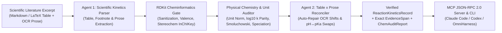
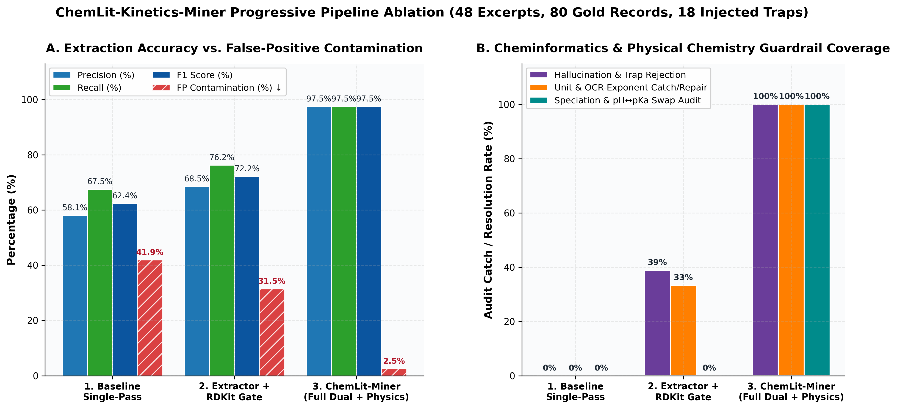
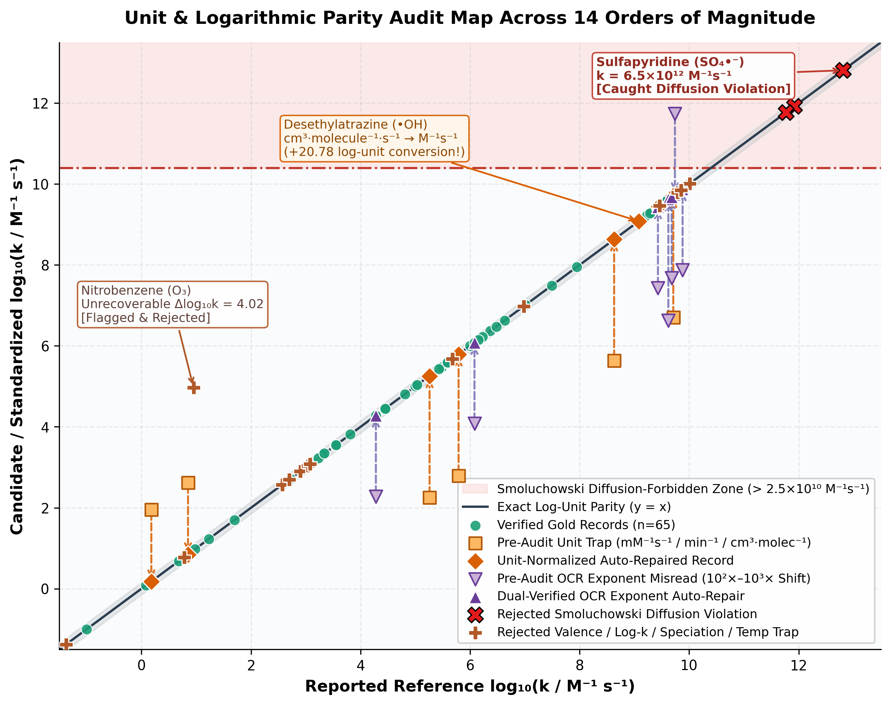
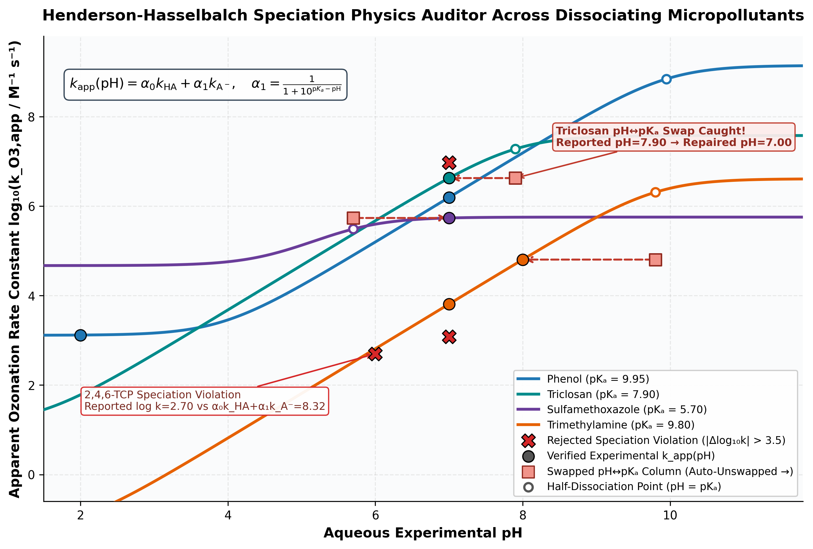
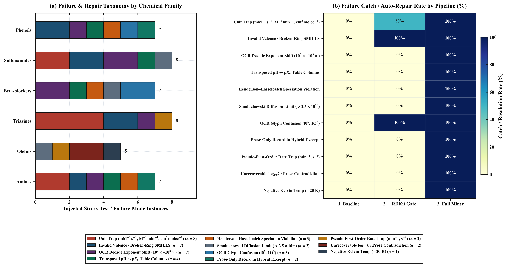

# ChemLit-Kinetics-Miner

**Evidence-Traceable Scientific Literature Extraction & Cheminformatics/Physics Verification Pipeline for Aqueous Oxidation Kinetics (with MCP Server & CLI)**

[](#installation--reproducibility)
[](#cheminformatics--domain-physics-audit-rules)
[](#model-context-protocol-mcp-integration)
[](LICENSE)

`ChemLit-Kinetics-Miner` is a closed-loop **AI4Science literature curation and domain-physics verification engine** designed to mine bimolecular aqueous oxidation rate constants ($`k_{\text{O}_3}`$, $`k_{\bullet\text{OH}}`$, $`k_{\text{SO}_4^{\bullet-}}`$, $`k_{\text{ClO}^\bullet}`$), experimental water-chemistry conditions ($`\text{pH}`$, $`T`$, $`\text{p}K_a`$, buffer matrix, radical scavengers), and canonical molecular structures (`SMILES`, `InChIKey`) from noisy environmental chemistry papers.

---

## Bridging Three Research & Systems Pillars

`ChemLit-Kinetics-Miner` unifies three complementary lines of work into a single verifiable scientific extraction stack:

1. **`DECAT` (Environmental Aquatic Chemistry & Reaction Kinetics Curation)**: Domain-grounded modeling of ozone and radical oxidation kinetics across dissociating organic micropollutants (phenols, sulfonamides, $`\beta`$-blockers, $`s`$-triazines, olefins, and amines), enforcing physical rate bounds and Henderson–Hasselbalch speciation laws.
2. **`shiye` / 识页 (Local-First Scientific Document & Formula/Table OCR Parsing)**: Tolerant parsing of Markdown pipe tables, LaTeX `\begin{tabular}` environments, table footnotes, and OCR-degraded scientific notations (`(3.2 ± 0.4) × 10^5 M^-1 s^-1`, `1.8 \cdot 10^{-2} L mol^{-1} s^{-1}`, `k_O3 < 0.1`, `10⁵`, `l0^5`, `1O^3`).
3. **`OmniHarness` & `local-chat-insights` (Dual-Agent Cross-Verification & Provenance)**: A `Generator × Domain-Physics Auditor` architecture that cross-checks extracted table rows against body prose, deterministically repairs recoverable OCR/column-shift errors, rejects chemical/physical hallucinations, and binds every accepted record to an exact `[char_start:char_end]` verbatim document span.



---

## Cheminformatics & Domain-Physics Audit Rules

Single-pass LLM and naive regex extractors routinely contaminate kinetic databases with broken OCSR SMILES, $`1000\times`$ millimolar unit inversions, OCR exponent misreads, and transposed $`\text{pH}/\text{p}K_a`$ columns. `ChemLit-Kinetics-Miner` enforces four hard scientific guardrails:

### 1. RDKit Valence, Ring & Skeleton Verification (`chemlit_miner/chem_validator.py`)
- Sanitizes raw SMILES via `RDKit` (`DetectChemistryProblems` + `SanitizeMol` + `AssignStereochemistry`), rejecting pentavalent carbons (e.g., `CC(=O)(=O)C`), pentavalent neutral nitrogens, and unclosed aromatic rings (`c1ccccc`).
- Computes canonical isomeric `SMILES`, 27-character `InChIKey`, Hill molecular formula, monoisotopic mass, and net formal charge.
- Cross-checks the 14-character `InChIKey` connectivity layer against named micropollutant skeletons to catch LLM name–structure mismatches.

### 2. Second-Order Unit Normalization & Logarithmic Parity Check
All second-order rate constants are converted to canonical $`\text{M}^{-1}\text{s}^{-1}`$ ($`\equiv \text{L}\cdot\text{mol}^{-1}\cdot\text{s}^{-1}`$):

```math
1\;\text{mM}^{-1}\text{s}^{-1} = 10^3\;\text{M}^{-1}\text{s}^{-1}, \qquad 1\;\text{M}^{-1}\text{min}^{-1} = \frac{1}{60}\;\text{M}^{-1}\text{s}^{-1}, \qquad 1\;\text{cm}^3\,\text{molecule}^{-1}\text{s}^{-1} = 10^{-3} N_{\text{A}}\;\text{M}^{-1}\text{s}^{-1}
```

Pseudo-first-order decay constants ($`\text{min}^{-1}`$, $`\text{s}^{-1}`$) lacking oxidant concentration dimensions are flagged (`PSEUDO_FIRST_ORDER_UNIT`). Whenever $`\log_{10} k`$ is co-reported, the auditor enforces:

```math
\left|\log_{10}\!\left(k_{\text{norm}}\right) - \text{reported }\log_{10} k\right| \le \tau \quad (\tau = 0.08)
```

catching $`10\times\text{--}1000\times`$ OCR exponent misreads and omitted footnote unit multipliers.

### 3. Smoluchowski Aqueous Diffusion Bound & Thermodynamic Bounds
Bimolecular aqueous oxidation reactions cannot exceed the Smoluchowski diffusion-controlled encounter limit at ambient conditions:

```math
0 < k_{\text{norm}} \le k_{\text{diff, max}} = 2.5 \times 10^{10}\;\text{M}^{-1}\text{s}^{-1}, \qquad T_{\text{K}} = T_{^\circ\text{C}} + 273.15 > 0\;\text{K}
```

### 4. Henderson–Hasselbalch Acid–Base Speciation Physics
Because ozone ($`E^\circ = 2.07\;\text{V}`$) is a highly selective electrophile, deprotonated phenolate ($`\text{A}^-`$) and neutral amine ($`\text{B}`$) species react $`10^4\text{--}10^7\times`$ faster than their conjugate acids ($`\text{HA}`$ / $`\text{BH}^+`$). When intrinsic species constants $`(k_{\text{HA}}, k_{\text{A}^-})`$ and $`\text{p}K_a`$ are available, the auditor verifies:

```math
k_{\text{app}}(\text{pH}) = \alpha_0(\text{pH})\,k_{\text{HA}} + \alpha_1(\text{pH})\,k_{\text{A}^-}, \qquad \alpha_1(\text{pH}) = \frac{1}{1 + 10^{\text{p}K_a - \text{pH}}}, \quad \alpha_0(\text{pH}) = 1 - \alpha_1(\text{pH})
```

(with full diprotic extension $`\alpha_0 k_0 + \alpha_1 k_1 + \alpha_2 k_2`$ for ampholytes). If $`k_{\text{app}}`$ fails under reported $`(\text{pH}, \text{p}K_a)`$ but satisfies the equation upon transposing $`\text{pH} \leftrightarrow \text{p}K_a`$ (corroborated by prose/reference $`\text{p}K_a`$), the auditor deterministically unswaps the transposed table columns (`AUTO_REPAIRED`).

---

## Gold-Standard Benchmark Evaluation

We evaluate three progressive pipeline configurations on `data/benchmark_corpus.json` (**48 environmental oxidation literature excerpts** across **Phenols, Sulfonamides, Beta-blockers, Triazines, Olefins, and Amines**, comprising **80 gold target records** and **18 injected real-world failure traps**):

| Pipeline Configuration | Precision | Recall | F1 Score | FP Contamination ↓ | Hallucination & Trap Rejection | Unit & Exponent Catch/Repair | Speciation & pH↔pKa Catch | Provenance + InChIKey Exact |
| :--- | :---: | :---: | :---: | :---: | :---: | :---: | :---: | :---: |
| **1. Baseline Single-Pass Extractor** | 58.1% | 67.5% | 62.4% | 41.9% | 0.0% (0/18) | 0.0% | 0.0% | 0.0% |
| **2. Extractor + RDKit Structure Gate** | 68.5% | 76.2% | 72.2% | 31.5% | 38.9% (7/18)* | 33.3% | 0.0% | 100.0% |
| **3. `ChemLit-Kinetics-Miner` (Full)** | **97.5%** | **97.5%** | **97.5%** | **2.5%** | **100.0% (18/18)** | **100.0%** | **100.0%** | **100.0%** |

*\*Note: Adding the RDKit gate alone rejects **100.0%** of structural/valence hallucinations, but cannot catch physics violations, pseudo-first-order unit traps, or speciation contradictions without the full Domain-Physics & Dual-Verification Auditor.*

### 1. Progressive Pipeline Ablation


### 2. Unit Normalization & Logarithmic Parity Audit Map


### 3. Henderson–Hasselbalch Speciation Physics Verification


### 4. Literature / OCR / LLM Failure Taxonomy Across Chemical Families


---

## Model Context Protocol (MCP) Integration

`chemlit_miner/mcp_server.py` implements a zero-external-framework **MCP JSON-RPC 2.0 stdio server** exposing three structured tools:
- `extract_kinetics_records`: End-to-end dual-agent extraction, RDKit canonicalization, physics verification, and `[char_start:char_end]` provenance binding.
- `validate_smiles_and_units`: Standalone RDKit sanitization + rate unit conversion + $`\log_{10} k`$ & Smoluchowski diffusion limit audit.
- `verify_speciation_kinetics`: Standalone monoprotic/diprotic Henderson–Hasselbalch $`k_{\text{app}}(\text{pH})`$ consistency & $`\text{pH}\leftrightarrow\text{p}K_a`$ swap checker.

Mount directly into **Claude Code**, **Codex**, **Cursor**, or **`OmniHarness`** (`mcpServers` configuration):

```json
{
  "mcpServers": {
    "chemlit-kinetics-miner": {
      "command": "python",
      "args": ["-m", "chemlit_miner", "mcp"],
      "cwd": "/path/to/ChemLit-Kinetics-Miner"
    }
  }
}
```

---

## Installation & Quickstart

### Installation

```bash
pip install -e ".[dev]"
```

### Command-Line Interface (`chemlit-miner`)

```bash
# 1. Extract & cross-verify kinetics records from a Markdown/LaTeX paper excerpt
python -m chemlit_miner extract --input paper_excerpt.md --doc-id "EST_2007_TCS" --mode full

# 2. Validate a SMILES structure, millimolar unit conversion, and log10(k) parity
python -m chemlit_miner validate --compound "Sulfamethazine" --k-value 620 --units "mM^-1 s^-1" --log-k 5.79

# 3. Verify Henderson-Hasselbalch speciation kinetics for Triclosan at pH 7.0
python -m chemlit_miner speciation --ph 7.0 --pka 7.90 --k-ha 13.0 --k-a-minus 3.8e7 --reported-k-app 4.25e6
```

### Python API

```python
from chemlit_miner import CrossVerificationEngine

excerpt = """
Ozonation in 10 mM phosphate buffer at pH = 7.0 and T = 298 K.
| Compound | SMILES | Oxidant | k_app (M^-1 s^-1) | log k | pH | pKa | k_HA (M^-1 s^-1) | k_A- (M^-1 s^-1) |
| --- | --- | --- | --- | --- | --- | --- | --- | --- |
| Triclosan | Oc1cc(Cl)ccc1Oc1ccc(Cl)cc1Cl | O3 | 4.25 × 10^6 | 6.63 | 7.90 | 7.00 | 13 | 3.8 × 10^7 |
At pH 7.0, Triclosan (pKa = 7.90) reacted rapidly with ozone with k_O3 = 4.25 × 10^6 M^-1 s^-1.
"""

engine = CrossVerificationEngine(mode="full")
result = engine.run(excerpt, doc_id="SUAREZ_2007")
rec = result.accepted_records[0]

print(rec.compound_name, rec.inchikey, rec.standardized_k, rec.ph, rec.audit_report.status)
# -> Triclosan XEFQLINVKFYRCS-UHFFFAOYSA-N 4250000.0 7.0 AUTO_REPAIRED
```

### Reproducing Benchmark Metrics, Figures & Tests

```bash
# Run full unit & integration test suite
pytest -v

# Rebuild gold benchmark corpus, run 3-stage pipeline ablation, and render 300 DPI figures
python scripts/build_benchmark_corpus.py
python scripts/run_evaluation.py
python scripts/generate_figures.py
```

---

## Repository Structure

```text
ChemLit-Kinetics-Miner/
├── chemlit_miner/
│   ├── __init__.py          # Public API exports
│   ├── __main__.py          # `python -m chemlit_miner` entrypoint
│   ├── schema.py            # Typed Pydantic v2 models (ReactionKineticsRecord, EvidenceSpan, ChemAuditReport)
│   ├── parser.py            # Markdown/LaTeX/OCR scientific table, footnote & prose parser
│   ├── chem_validator.py    # RDKit structure gate, unit normalizer, Smoluchowski & speciation physics
│   ├── cross_verifier.py    # Dual-Agent (Extractor x Domain-Physics Auditor) engine + optional LLM client
│   ├── mcp_server.py        # Standard MCP JSON-RPC 2.0 stdio server & tool registry
│   └── cli.py               # Command-line interface (`extract`, `validate`, `speciation`, `mcp`)
├── data/
│   └── benchmark_corpus.json # 48 realistic literature excerpts (80 gold records + 18 failure traps)
├── scripts/
│   ├── build_benchmark_corpus.py
│   ├── run_evaluation.py    # Computes real ablation metrics -> results/
│   └── generate_figures.py  # Generates 4 publication-grade 300 DPI figures -> assets/
├── results/
│   ├── miner_benchmark.json # Full pipeline metrics & candidate parity audit trace
│   └── error_breakdown.csv  # Caught failure taxonomy across 6 chemical families
├── assets/                  # 300 DPI benchmark & domain-physics diagnostic figures
├── tests/
│   └── test_miner.py        # 17 comprehensive pytest unit & integration tests
├── pyproject.toml
├── requirements.txt
└── LICENSE
```

## License

Released under the [MIT License](LICENSE).
